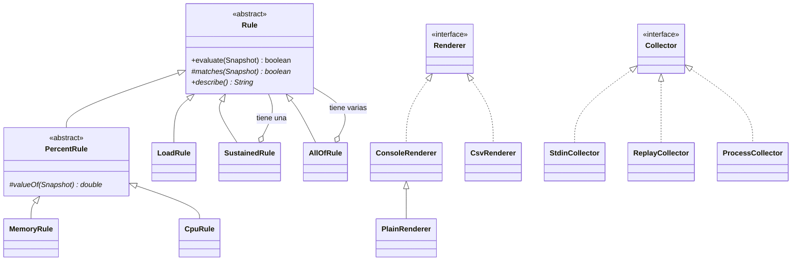

# Sentinel — Fase 3: herencia y polimorfismo

La versión de Sentinel después de las [Clases 8](../../Apuntes/Clase08-Guia.md) y [9](../../Apuntes/Clase09-Guia.md). Hace lo mismo que la Fase 2 y bastante más: varias reglas a la vez, alertas sostenidas, reglas combinadas, tres formatos de salida y tres fuentes de datos. Lo importante no es la cantidad de funciones, sino que **agregar una más no obliga a tocar el motor**.

## Cómo correr

Desde `sentinel/phase3-java`, en WSL o macOS:

```bash
chmod u+x build.sh
./build.sh                       # compila todo y corre el autochequeo: Result: 46/46

java -cp out sentinel.app.Main --help
java -cp out sentinel.app.Main --replay=../phase1-bash/samples/muestra-2026-09-17.txt
```

Algunas combinaciones para mostrar en clase:

```bash
S=../phase1-bash/samples/muestra-2026-09-17.txt

java -cp out sentinel.app.Main --replay=$S --cpu=60                      # dos reglas
java -cp out sentinel.app.Main --replay=$S --cpu=60 --load=2.0 --sustain=2   # solo picos que duran
java -cp out sentinel.app.Main --replay=$S --cpu=80 --all                # memoria Y cpu a la vez
java -cp out sentinel.app.Main --replay=$S --render=csv > lecturas.csv   # para una hoja de cálculo
java -cp out sentinel.app.Main --run=../phase1-bash/collector.sh --lines=5   # Java lanza el colector
../phase1-bash/collector.sh | java -cp out sentinel.app.Main            # o por pipe, como siempre
```

## Estructura: un paquete por responsabilidad

```
src/sentinel/
├── model/     Snapshot, Contract, History        los datos: igual que en la Fase 2
├── collect/   Collector + 3 implementaciones      de dónde vienen las líneas
├── rules/     Rule + 6 subclases                  cuándo hay alerta
├── render/    Renderer + 3 implementaciones       cómo se muestra
└── app/       Config, Factory, Sentinel, Main     la configuración y el motor
test/sentinel/check/SentinelCheck.java             el autochequeo, 46 pruebas
```

Es la estructura que la [visión del proyecto](../../sentinel-readme.md) proponía desde el principio: `model`, `collect`, `rules`, `render`, `app`.

## Dónde está la herencia



| Dónde | Qué enseña |
|---|---|
| `Rule.evaluate()` es `final` | El padre fija **cómo** se cuentan las alertas. Ningún hijo puede romperlo. |
| `PercentRule` | Una clase abstracta intermedia, como `DiscountTicket` en el cine: guarda la validación 1..100 que comparten memoria y CPU. |
| `LoadRule` hereda directo de `Rule` | La respuesta a la pregunta de la tarea de la Clase 8: la carga no es un porcentaje, así que no puede vivir bajo `PercentRule`. Una clase base solo debe tener lo que es cierto para **todos** sus hijos. |
| `PlainRenderer extends ConsoleRenderer` | Un buen uso de la herencia: una salida sin colores **es una** salida de consola. Reusa todo y cambia dos métodos. |
| `CsvRenderer` **no** hereda de `ConsoleRenderer` | Un CSV no es un reporte de consola. Heredar sería el error de las pipocas del Drill 5. |

## Dónde está el polimorfismo

| Dónde | Qué enseña |
|---|---|
| [Sentinel.java](src/sentinel/app/Sentinel.java) | El motor solo conoce `Collector`, `Rule` y `Renderer`. **Sus `import` no nombran ninguna clase concreta.** Funciona igual con un archivo o un pipe, con una regla o diez, con colores o CSV. |
| [Factory.java](src/sentinel/app/Factory.java) | El único lugar del programa que nombra clases concretas, y el único con un `switch`. En el borde, el texto de la línea de comandos tiene que convertirse en objetos; después, nadie vuelve a preguntar "¿qué tipo eres?". |
| `SustainedRule` y `AllOfRule` | Composición más polimorfismo. Una regla sostenida **tiene** cualquier regla adentro; hacia afuera es una regla más. Con herencia habría hecho falta `SustainedMemoryRule`, `SustainedCpuRule`, `SustainedLoadRule`... |
| `RecordingRenderer` en el autochequeo | Un *test double*: un `Renderer` que no imprime nada y solo cuenta. El motor no nota la diferencia porque solo conoce la interfaz. Así se prueban los sistemas reales. |

## Lo bueno y lo malo, en este mismo código

**Lo bueno, medible:** agregar una regla nueva, por ejemplo una de procesos, es una clase de diez líneas y una línea en `Factory`. `Sentinel`, los renderers y el autochequeo existente no se tocan.

**Lo que cuesta:**

- **Más archivos.** La Fase 2 tenía seis; esta tiene veintiuno. Para un programa que nunca va a cambiar, es demasiado. La estructura se paga sola solo si el programa crece.
- **La clase base decide por todos.** `PercentRule` existe porque la primera versión de `Rule` tenía la validación 1..100 y `LoadRule` no encajaba. Mover algo de lugar en una jerarquía obliga a revisar a todos los hijos.
- **Reglas con memoria.** `SustainedRule` recuerda la racha. Por eso `AllOfRule` pregunta a **todas** sus partes, incluso cuando una ya dijo que no: saltarse una le rompería la memoria. Es la misma trampa del `||` de la Clase 9, y tiene su propia prueba en el autochequeo.

## Ideas para ejercicios sobre esta base

Cada una se resuelve con una clase nueva y una línea en `Factory`, sin tocar `Sentinel`:

1. `ProcsRule`: alerta si hay más de N procesos. ¿Hereda de `PercentRule` o de `Rule`? ¿Por qué?
2. `AnyOfRule`: alerta si **alguna** de sus partes coincide. Cuidado con la trampa del `||`.
3. `JsonRenderer`: una línea JSON por lectura. El círculo se cierra: Sentinel también puede producir el contrato.
4. `--render=quiet`: un renderer que solo imprime las alertas.
